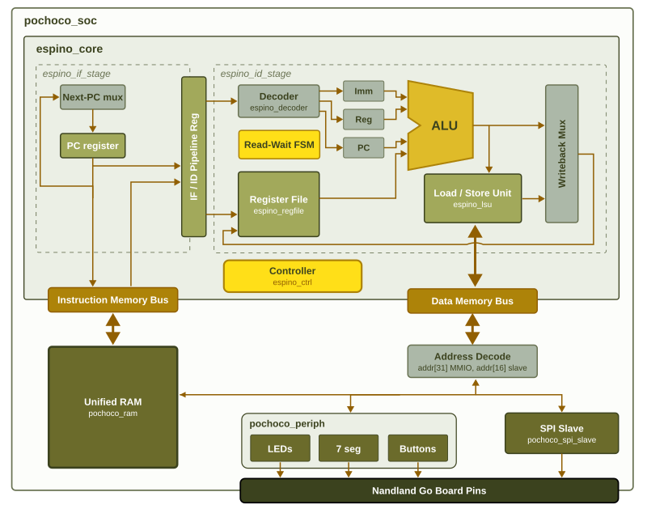

# Proyecto 4 — Pochoco Trader

Agente RV32E para Go Board. Espino ejecuta trade.hex y escribe DECISION. El periférico MMIO SMA10 acelera la suma móvil. La versión de competencia recibe precios por SPI externo.

- [Guía de compilación, conexiones y pruebas](proyecto4/README.md)
- [Informe final PDF](proyecto4/entrega_final/informe_final_proyecto4.pdf)
- [Matriz de requisitos y evidencia](proyecto4/documentacion/matriz_cierre_pochoco.md)
- [Guía de defensa](proyecto4/documentacion/guia_defensa.md)
- [Auditoría final y comandos reproducibles en Windows](proyecto4/documentacion/auditoria_final_cierre.md)

Las tres rondas de práctica pasaron 4/4 criterios en Icarus, con 20.000 ticks por ronda y arquitectura y cero diferencias frente a Python. La demo autónoma de 16 ticks obtuvo PASS físico. También se registró una práctica con la FPGA maestra en Fila 2, con cotejo por tick y verificación del BIN pendientes. [Registro de la práctica física](proyecto4/pruebas_fisicas/spi_externo_robusto/README.md#práctica-física-en-fila-2)

## Referencia del Proyecto 2
> **Revision del juego:** instrucciones actuales, mapa MMIO y pruebas en [REVISION.md](REVISION.md).

# Pochoco SoC & Espino Core

> Meet Pochoco SoC and Espino Core. Inspired by the native flora of the Pochoco trails, it is an entry-level, highly efficient architecture designed to flourish in resource-constrained environments.



Welcome to the repository! This project contains the RTL for a custom 32-bit processor and its surrounding System-on-Chip (SoC) designed for FPGA deployment. The design is kept straightforward to help explore and understand computer architecture fundamentals.

This is meant to be forked, not just cloned. You'll be poking around the RTL, so make it your own, we won't judge (we might even be a little proud).

## Repository Structure

The hardware is written in Verilog and divided into these main categories:

* **The Espino Core**: The central processing unit. It includes all standard pipeline stages like instruction fetch, instruction decode, an ALU for execution, a register file, a load/store unit for memory operations, and a pipeline controller. It implements [RV32E](https://docs.riscv.org/reference/isa/v20260120/unpriv/rv32.html) with a catch you might want to check out the code for.
* **The Pochoco SoC**: The top-level system wrapper. It connects the CPU core to a unified instruction/data RAM, physical board peripherals (like LEDs, switches, and displays), and an external SPI slave interface.
* **Build Files**: Constraints to map the design to the physical FPGA pins, and automation scripts for synthesis, routing, and flashing using an open-source toolchain.

## Memory Map

The SoC routes memory and data requests using a hardcoded address decoding scheme based on the highest bits of the 32-bit address.

* **`0x0000_0000` - Unified RAM**: The shared memory space for both instructions and data.
* **`0x8000_0000` - Board Peripherals**: Memory-mapped I/O for the physical board.
  * `Offset 0x00`: 7-Segment Displays
  * `Offset 0x04`: LEDs
  * `Offset 0x08`: Button Inputs
* **`0x8001_0000` - SPI Slave**: Custom SPI interface routing.
  * `Offset 0x00`: SPI Status (Chip Select state, New Data flag)
  * `Offset 0x04`: Received "Price" byte (from external master)
  * `Offset 0x08`: "Decision" byte (written by CPU to transmit)

Dive into the source code to see exactly how these components and connections are built under the hood!

## How to Build

To synthesize and build the project, you will need the open-source FPGA toolchain.

1. Install the tools by following the instructions at the [oss-cad-suite-build repository](https://github.com/yosyshq/oss-cad-suite-build).
2. Once installed, ~~blindly copy-paste~~ (we strongly encourage reading the Makefile first to make sure we aren't deleting your home directory) the following command in the project root to generate and program the final bitstream:

```bash
make all   # build only; use make prog to flash
```

## Software

The `sw/` folder contains the game and RV32E examples. Use the project assembler:

```sh
python sw/assembler.py sw/game.s -o sw/game.hex
python -B tests/run_tests.py
```

From `sw/`, `make` builds all examples using the same Python assembler. The top-level
build regenerates the game image automatically. No external RISC-V assembler is needed.

Shifts are intentionally absent from the ALU to save LUTs. The assembler rejects
them and the hardware decoder suppresses their side effects. See [REVISION.md](REVISION.md)
for the supported subset, game timing, updated MMIO registers and verification limits.

## Proyecto 4 — Pochoco Trader

El desarrollo de Proyecto 4, construido sobre este Espino, está en [`proyecto4/`](proyecto4/README.md). Ese README contiene las instrucciones de ensamblado, simulación, síntesis/programación, versiones detectadas y estado de validación. La variante de hardware elegida es MMIO SMA10 base.

La [guía de Windows](proyecto4/README.md#repetir-la-validación-de-2000-ticks-en-windows) indica cómo ejecutar el banco de 2.000 ticks. El PDF y el manifiesto de entrega están en `proyecto4/entrega_final/`.

