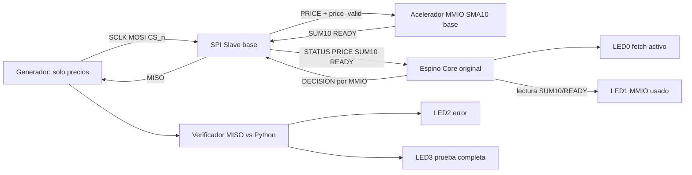

# Validación física del agente completo

Esta variante independiente conecta un maestro SPI interno de precios con el SPI Slave del Pochoco SoC MMIO SMA10 base. El maestro solo envía bytes de precio. `trade.hex` lo ejecuta el Espino y el Espino escribe DECISION; el acelerador SMA10 solo mantiene la ventana y expone SUM10/READY.

## Estructura

- `rtl/price_generator.v`: maestro SPI, secuencia fija de precios y captura observacional de MISO.
- `rtl/decision_verifier.v`: compara MISO con el vector generado por el modelo Python; no conduce el SoC.
- `rtl/agente_completo_top.v`: conecta generador, verificador y SoC; LEDs de diagnóstico.
- `rtl/pochoco_soc_observable.v`: copia aislada del SoC base con puertos de observación; la lógica funcional instancia el Espino y los bloques de `alternativas/mmio_sma10/rtl/` sin alterarlos.
- `tb/tb_agente_completo.sv`: inspecciona reset, fetch, commit, accesos MMIO, tick y verificación MISO.
- `data/`: 16 precios y respuestas esperadas de Python.

## Conexiones verificadas



El verificador solo recibe el byte MISO muestreado y lo compara; no conduce líneas SPI, buses del SoC ni DECISION.

## Reproducir simulación

Desde la raíz `pochoco_soc-main` en PowerShell:

```powershell
powershell -NoProfile -ExecutionPolicy Bypass -File proyecto4/pruebas_fisicas/agente_completo/ejecutar_simulacion.ps1
```

El test verifica STATUS/PRICE/DECISION, SUM10/READY, reset, fetch y commit, byte MISO tick a tick contra Python, ausencia de respuestas desconocidas y que cada escritura DECISION del bus Espino coincide con la salida Python calculada en ese tick. La decisión escrita se recibe por MISO en la transacción siguiente. La secuencia tiene 16 ticks: diez precios iniciales llenan SMA10, tres precios bajos provocan una compra y tres precios altos provocan una venta. `expected_decisions.hex` contiene los bytes recibidos por MISO y `expected_writes.hex` contiene los bytes que el firmware debe escribir.

## Síntesis temprana

El PCF independiente usa reloj pin 15 y LED pins 56, 57, 59 y 60, heredados del `goboard.pcf` del proyecto. No asigna SPI externos: el maestro está conectado internamente. Desde la raíz:

```powershell
powershell -NoProfile -ExecutionPolicy Bypass -File proyecto4/pruebas_fisicas/agente_completo/ejecutar_sintesis.ps1
```

El script ejecuta Yosys y nextpnr HX1K/VQ100 a 25 MHz; `icepack` solo se ejecuta si el place and route pasa. MemFile y vectores se resuelven desde la raíz del repositorio.

LED0: fetch del Espino. LED1: el Espino leyó SUM10 o READY. LED2: discrepancia MISO. LED3: generador terminado, 16 respuestas comprobadas, 16 escrituras DECISION y sin discrepancias.

La copia observable añade solamente taps de señales ya presentes en el SoC base. No modificar el árbol MMIO base. El bitstream solo se considera entregable si Yosys, nextpnr HX1K/VQ100 y timing terminan correctamente con no más de 1.280 LC.

## Resultado inicial de síntesis

La simulación pasó con 16/16 respuestas MISO iguales a Python. Cada DECISION escrita por el bus del Espino también coincidió con la decisión Python calculada en el tick anterior. La síntesis temprana no cabe en HX1K: Yosys produjo 1.295 LUT4 y nextpnr estimó 1.550/1.280 Logic Cells (121%) y 13/16 BRAM. El P&R falló por exceso de celdas antes de obtener Fmax; no se generó `.bin`. La referencia MMIO base registrada usa 1.279/1.280 LC, 13/16 BRAM y Fmax de 40,50 MHz. No se modificó ni sustituyó la referencia. Los logs están en `build/`.
