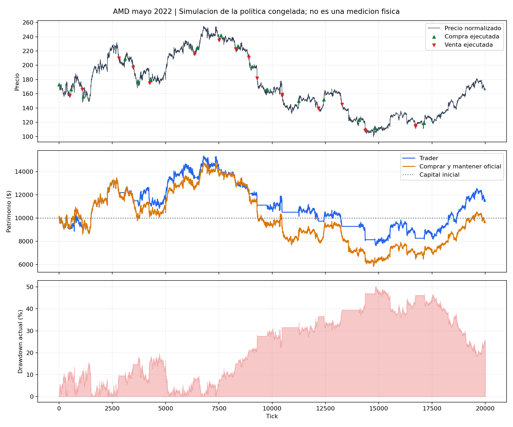

# Simulacion — AMD mayo 2022

Se reprodujeron 20,000 ticks de una serie conocida de practica con la politica congelada.
La estrategia usa solo los precios recibidos hasta cada decision; el visor reproduce una traza
precalculada a velocidad humana. No se consulto ni midio una FPGA fisica.

| Medida | Resultado |
|---|---:|
| Capital inicial | $10.000 |
| Patrimonio final Trader | $11,490 |
| Comprar y mantener oficial | $9,647 |
| Ventaja absoluta | $1,843 |
| Ventaja relativa | 19.10% |
| Caja final | $36 |
| Acciones finales | 69 |
| Ordenes ejecutadas | 45 |
| Comisiones | $225 |
| Drawdown maximo absoluto | $7,730 |
| Drawdown maximo porcentual | 50.39% |

`ticks.csv` contiene todos los precios y estados. `operaciones.csv` contiene solo fills
reales del modelo. `resumen.json` conserva parametros y hashes de procedencia.
MISO en el tick n ejecuta la decision calculada en n-1 al precio de n. La decision
calculada despues del ultimo precio no se ejecuta. Cada orden ejecutada paga $5;
la cantidad se recorta a caja/inventario y a 63 acciones por byte.

El benchmark oficial compra idealmente en tick 0 con una sola comision y puede superar
63 acciones; tiene esa ventaja respecto del SPI real. El firmware comienza con MISO=0.
Estos datos ya se usaron durante desarrollo: este resultado no es validacion independiente
ni demuestra el resultado de la competencia secreta. La velocidad de animacion no mide
el deadline del procesador; para eso se usan los testbenches RTL.

La traza RTL archivada, cuando esta disponible, se copia a `referencia_RTL.csv` y se
coteja en todos los ticks contra el modelo antes de exportar. Esto permite distinguir
evidencia RTL previa de una simulacion RTL nueva y de la prueba fisica pendiente.
